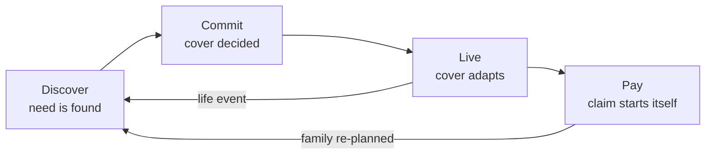
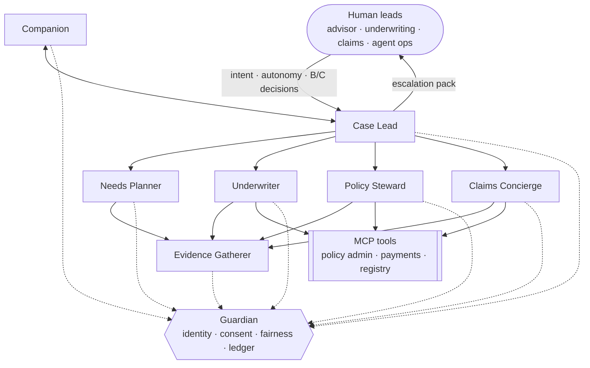

# Living Cover — an agent-run life insurance design

Status: design (frame + design). No code, no cloud. Fictional insurer, people and figures.
Future state only. Enterprise frame: [agentic life insurer operating model](reference-operating-model.md).

## 1. Idea in one line

**An agent team runs life insurance end to end — from first need to final payment — and humans lead it:
they set intent, set autonomy, and own the judgement calls.**

One continuous loop: owned by a Case Lead agent per household, worked by specialist agents, observed by
the client, led by named humans, governed by one trust layer.

## 2. Design principles

| # | Principle | Shows up as |
| --- | --- | --- |
| 1 | Agent team runs end to end; humans lead | Case Lead agent owns each household outcome; human leads set intent, autonomy and guardrails and own level B/C decisions (§5) |
| 2 | Event-driven, not form-driven | Life events (baby, mortgage, diagnosis) trigger work |
| 3 | Consent is a live object | Client grants, sees and revokes each data source in a Consent Wallet |
| 4 | Every action is visible | One Action Ledger: agent, action, evidence, autonomy level, human lead, time |
| 5 | Explain every decision | Decisions carry plain-language reason codes |
| 6 | One record, many views | Client, advisor, insurer and agent ops see the same world through different lenses |
| 7 | Legacy as tools | Policy admin systems reached only through governed API/MCP tools |
| 8 | Governed by design | Every agent has identity, owner, permissions and audit trail |
| 9 | Autonomy is earned | Decision types move between levels on ledger evidence, approved by a human lead |

## 3. Where it sits: six layers

Living Cover is the customer-journey slice through the [operating model](reference-operating-model.md) layers.

| Layer | In Living Cover |
| --- | --- |
| 1 Experiences | Client app (chat + voice), advisor desk, insurer/claims desk, agent ops console |
| 2 Humans as agent leaders | Four human leads (§5): advisor, underwriting lead, claims lead, agent ops lead |
| 3 Agent workforce | One agent team: Case Lead + six specialists (§4) |
| 4 Knowledge & data | One household record; product rules & PDS knowledge; consented external data |
| 5 Integration & legacy access | Policy admin, payments and registry exposed as MCP tools |
| 6 Trust & governance | Guardian: agent identity, consent, fairness, CPS 230/234 controls, Action Ledger |

## 4. Agent team

One team per household. The **Case Lead** owns the outcome ("this household is correctly covered and
paid on time") from Discover to Pay; specialists do the work; human leads direct the team.

| Agent | Serves | Does | Never does | Reference agent |
| --- | --- | --- | --- | --- |
| **Case Lead** | Household | Owns the end-to-end case; plans next steps; delegates to specialists; tracks targets; escalates B/C decisions to the right human lead with a ready pack | Make a B/C decision itself | Unit of work: "agent team with a human lead" |
| **Companion** | Client | Chat and voice front door; life-event detection; status in plain words; spots vulnerability and hands over with context | Give personal advice; decide cover | Contact centre |
| **Needs Planner** | Client + advisor | Computes protection gap from consented data; drafts options, quote and advice record | Issue advice without advisor sign-off | Advice & quote |
| **Evidence Gatherer** | All | Pulls consented data (bank, health record, payslip, GP report, registry); states what it used | Read any source not in the Consent Wallet | Underwriting evidence |
| **Underwriter** | Insurer | Risk decision + price; auto-accepts clear cases; runs ID/AML; issues policy; refers the rest with a draft | Decline or load premium without human underwriter | Underwriting evidence, Onboarding & KYC |
| **Policy Steward** | Client + advisor | Watches life events; proposes cover changes; handles the long tail of servicing (beneficiary, address, payment) | Change cover without client tap | Policy servicing |
| **Claims Concierge** | Claimant + assessor | Opens claim from one message or trigger; gathers proof; builds assessment pack; recommends rehab; pays | Deny or reduce a claim without human assessor | Claims triage & assessment |

**Guardian** (reference: Compliance & finance) — not a worker; the policy layer every agent calls. Checks
identity, consent, fairness (no prohibited factors), advice rules, complaint signals and CPS 230/234 controls;
writes every action to the Action Ledger.

Out of demo scope: Retirement guidance agent (same pattern, later extension).

## 5. Human-led, agent-run

### Human leads

Humans do not sit inside the process steps; they lead the team.

| Human lead | Leads | Sets | Decides |
| --- | --- | --- | --- |
| Advisor | The client relationship | Client goals and advice boundaries | Advice record (B) |
| Underwriting lead | Risk appetite | Rules, referral thresholds | Referrals (B); declines, loadings, exclusions (C) |
| Claims lead | Claims outcomes and care | Evidence standards, fraud thresholds | Payments (B); denials, reductions, vulnerable claimants (C) |
| Agent ops lead | The agent workforce | Autonomy level per decision type; agent identity and permissions | Promote or demote autonomy |

The client leads their own choices: any change to their cover needs their tap, at every level.

### Autonomy levels

Set per decision type by the agent ops lead; shown and editable in the Agent Ops console.

| Level | Meaning | Decisions |
| --- | --- | --- |
| A — Act | Agent acts, logs | Gather consented evidence; status updates; address/payment changes; accept clear-case cover; reconcile payment |
| B — Propose | Agent drafts, named human approves | Advice record (advisor); beneficiary update (advisor); cover increase (client tap); referral outcome (underwriting lead); claim payment (claims lead) |
| C — Human only | Agent prepares pack, human decides and owns | Decline, loading or exclusion; claim denial or reduction; vulnerable-customer handling |

### Earned autonomy

- **Promote B → A:** Case Lead proposes when the ledger shows sustained agreement between agent drafts and
  human decisions for that decision type (illustrative rule: ≥ 98% over the last 200 cases, no Guardian breach).
  Agent ops lead approves.
- **Demote A → B:** automatic on a Guardian breach, complaint signal or drift alert; agent ops lead reviews.
- **Level C never promotes.** Adverse decisions stay human.

## 6. The process, by moment

Each moment: trigger, agent team, human lead role, screen, target. The Case Lead runs every moment and hands over to the next; no human handoff between moments. Targets are design intent, not measurements.

### 6.1 Discover — "you are under-covered, here is why"

- **Trigger:** client tells Companion "we're having a baby", or Policy Steward sees a new mortgage in consented bank data.
- **Agents:** Evidence Gatherer reads income, debts, super cover. Needs Planner computes the gap, drafts 3 options and the advice record.
- **Human lead (B):** advisor reviews and signs the advice record on one screen.
- **Screen:** Protection Gap meter, three option cards, Consent Wallet with sources lit.
- **Target:** same day.

### 6.2 Commit — "decided in minutes, with reasons"

- **Trigger:** client picks an option.
- **Agents:** Evidence Gatherer pulls health summary with consent; Underwriter decides, runs ID/AML, issues policy through the policy admin tool. Unclear cases referred with draft and reason codes.
- **Human lead (B/C):** underwriting lead on referrals; any exclusion or loading is level C.
- **Screen:** Decision card (outcome, premium, reasons, data used); policy in wallet.
- **Target:** clear case < 10 min; referral same day.

### 6.3 Live — "cover that keeps up"

- **Trigger:** life events (new child, pay rise, debt paid off, beneficiary change).
- **Agents:** Policy Steward proposes change or completes servicing (level A); Needs Planner recomputes gap; Underwriter re-prices if needed.
- **Human lead (B):** client tap; advisor notified, steps in on material advice.
- **Screen:** Life timeline, gap meter moving, proposed-change card.
- **Target:** within a day of the event.

### 6.4 Pay — "the claim starts itself"

- **Trigger:** claimant message ("I've been diagnosed") or trusted feed (registry, hospital record with consent).
- **Agents:** Claims Concierge opens claim, confirms cover instantly, lists what it has vs needs; Evidence Gatherer requests GP and treating-doctor reports electronically; Concierge builds assessment pack against policy terms, flags fraud signals, recommends rehab support, prepares payment.
- **Human lead (B):** claims lead approves payment or takes over.
- **Screen:** Claim tracker, evidence checklist auto-ticking, payment confirmation, then Policy Steward offering a family re-plan.
- **Target:** clean claim paid within 24 h of first message.

## 7. Demo: one family, one timeline

One fictional household on one sim clock. Four acts map to the four moments. Each act 60–90 s.

| Cast | Role |
| --- | --- |
| Mia Tan, 34, nurse, Sydney | Client |
| Ben Tan, 36, electrician | Partner, second life insured |
| Raj Iyer | Advisor at a fictional practice |
| Kestrel Life (fictional) | Insurer; underwriting lead Sam Okafor; claims lead Lena Ward; agent ops lead Priya Shah |

| Act | Sim date | Story beat | Key visual | Human lead |
| --- | --- | --- | --- | --- |
| 1 Discover | 2026-03-02 | Mia tells Companion she is pregnant; gap meter shows AUD 1.15m need vs AUD 300k held via super | Gap meter + Consent Wallet | Raj signs advice |
| 2 Commit | 2026-03-02 | Mia auto-accepted: AUD 1.0m life + AUD 150k trauma, AUD 96/month. Ben referred (prior back injury), accepted same day with exclusion | Decision cards; Ben in underwriter queue | Sam on Ben (level C exclusion) |
| 3 Live | 2026-09-14 | Baby born; beneficiary update drafted (level B, Raj approves); mortgage refinanced to AUD 820k; Steward proposes +AUD 200k | Life timeline; meter re-closes | Raj (beneficiary), Mia's tap (cover) |
| 3b Lead | 2026-11-02 | Case Lead proposes promoting "beneficiary update after birth" from B to A (200/200 agreement, no breach); Priya approves | Autonomy board: dial moves B → A, evidence shown | Priya approves |
| 4 Pay | 2027-05-20 | Ben diagnosed with a covered trauma condition; claim starts from one message; paid next day | Claim tracker + evidence auto-ticking + payout | Lena approves |

All figures are illustrative; the build produces them from a seeded generator, never typed into code.

### Four views, one world

| View | Primary panel | Shows |
| --- | --- | --- |
| Client app (phone frame) | Companion chat | Conversation, gap meter, decision card, claim tracker |
| Advisor desk | Client book + review queue | Needs Planner drafts, Steward alerts, sign-off |
| Insurer / Claims desk | Referral and claim queues | Underwriter referrals, Concierge assessment packs, approve/override |
| Agent Ops console | Agent team + autonomy board | Each agent's identity, owner, level per decision, live ledger, Guardian blocks |

Shared across views: **Action Ledger** strip (agent · action · evidence · autonomy level · human lead · time).

UI / UX (React + React Three Fiber diorama with mini figures, lens panels, interaction model): [UI-UX.md](UI-UX.md).

### Visual elements

1. Protection Gap meter (need vs held, moves with events).
2. Consent Wallet (sources on/off, last used by which agent).
3. Decision card (outcome, price, reason codes, data used).
4. Life timeline (events, proposed and accepted changes).
5. Claim tracker (opened → evidence → assessed → approved → paid) with checklist.
6. Action Ledger (filter by agent, level, human lead).
7. Autonomy board (A/B/C per decision type, promote/demote history with evidence; Guardian block when an agent tries a level-C action).

## 8. Data (synthetic, generated)

| File | Holds |
| --- | --- |
| `data/household.json` | People, incomes, debts, existing super cover |
| `data/consents.json` | Source, scope, granted/revoked times |
| `data/events.json` | Life events with sim timestamps |
| `data/decisions.json` | Underwriting and claim decisions with reason codes and autonomy level |
| `data/ledger.json` | Every agent action, cause → effect ordered |
| `data/products.json` | Fictional product rules and rate table |
| `data/agents.json` | Agent team: identity, owner, permissions, autonomy per decision type, promote/demote history |

Checks (exit 1 on fail): no effect before cause; no timestamp after `world_now`; gap = need − held recomputes;
premium recomputes from rate table; every level B/C decision has a human-lead entry; every autonomy change has evidence and a human approval.

## 9. Fit with the roadmap

The demo shows [phase 3](reference-operating-model.md#3-getting-there) (human-led, agent-operated) for one
household. Its claim act matches the reference's first-90-day value stream: claims intake.

## 10. Out of scope

Real carrier systems, real health or bank data, regulatory filings, actuarial accuracy, deployment,
retirement guidance.

## 11. Open decision

Demo fork: **Replay** (scripted presenter walkthrough, offline) or **Live** (Foundry-hosted agents on a
per-session sim clock, cold users drive it). Recommendation: Replay first; Live reuses the same data and views.

## 12. Sources

| Signal | Source |
| --- | --- |
| ~59% of US individual life applications qualify for accelerated underwriting — straight-through is mainstream | [Gen Re 2025](https://www.genre.com/us/aboutus/press-media/2025-gen-re-releases-us-individual-life-next-gen-uw-survey-results-en) |
| Insurers moving to orchestrated multi-agent workflows; data and governance are prerequisites | [Deloitte](https://www.deloitte.com/ap/en/about/press-room/deloitte-launches-new-paper-on-scaling-agentic-ai-in-life-insurance.html), [McKinsey](https://www.mckinsey.com/industries/financial-services/our-insights/can-agentic-ai-finally-modernize-core-technologies-in-insurance) |
| Explainability, fairness and audit of automated decisions are the main regulatory demand | [Deloitte blueprint](https://www.deloitte.com/global/en/what-we-do/capabilities/ai/services/agentic-ai-blueprint-for-insurance.html) |
